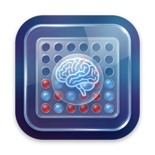
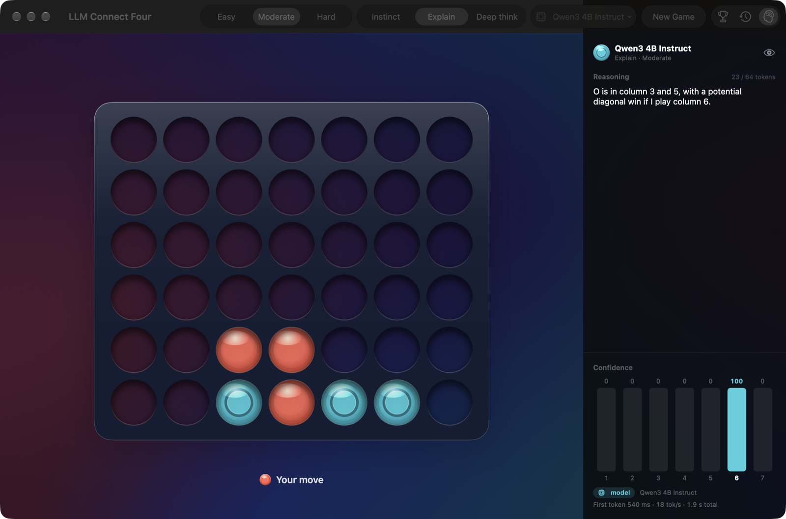
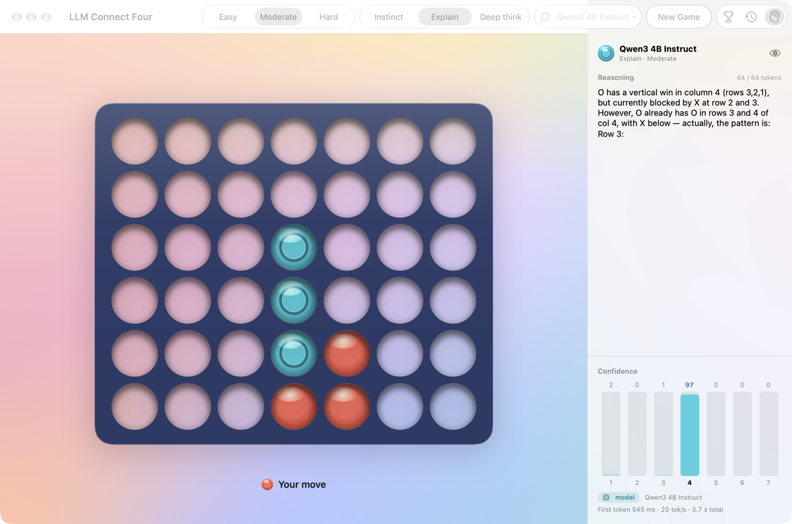
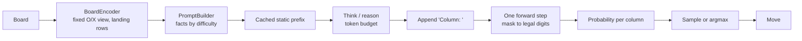

<p align="center">
  
</p>

<h1 align="center">LLM Connect Four</h1>

<p align="center">
  Play Connect Four against a language model running entirely on your Mac, and watch it think.<br>
  No cloud, no API key.
</p>

<p align="center">
  
  
  
  
  
</p>

<p align="center">
  <a href="https://github.com/komi-builds/LLM-Connect-Four/releases/latest"><b>Download the latest release (.dmg)</b></a>
</p>



## What it is

A native SwiftUI Connect Four game where the opponent is a small open-weight language model
(Qwen3 4B by default) running in-process with [MLX](https://github.com/ml-explore/mlx-swift).
The model really decides every move: it reads the board, optionally reasons, and then the
app writes `Column: ` and restricts the next token to the legal column digits. Nothing is
hardcoded and no output is parsed, so an illegal move is impossible.

- **Watch it think.** The Thinking panel streams the model's reasoning live, with a bar for
  the probability of every column and a glow over the board as it leans toward a move.
- **Three thinking styles.** Instinct (one forward pass, about 0.5 s), Explain (one short
  sentence first, about 1.5 s) and Deep think (native `<think>` mode with a token budget).
- **Three difficulties.** Easy, Moderate and Hard change how much help the prompt gives and
  how freely the answer is sampled. On Hard the model is re-prompted once if it misses a win
  or a block. The model always chooses.
- **What the model sees.** The eye button shows the exact prompt for any move, with the
  facts given to the model highlighted.
- **Replay** any game move by move, with each move's prompt, reasoning and probabilities.
- **A built-in benchmark** that ranks any model and setting on one rating scale, in the app
  and from the command line.
- Native macOS 26 design with Liquid Glass for controls, light and dark mode, VoiceOver and
  the Reduce Motion / Reduce Transparency / Increase Contrast settings.



## Install

1. Download `LLMConnectFour-<version>.dmg` from the
   [latest release](https://github.com/komi-builds/LLM-Connect-Four/releases/latest).
2. Open it and drag **LLM Connect Four** to Applications.
3. The app is not notarized, so macOS blocks the first launch. Right-click the app and
   choose **Open**, or allow it in **System Settings > Privacy & Security**.

On first launch the app downloads the default model (about 2.3 GB) from Hugging Face while
you make your first move. After that it works offline.

**Requirements:** a Mac with Apple Silicon (M1 or newer) and macOS 26 or later. 16 GB of
memory is comfortable; on 8 GB pick Qwen3 1.7B in Settings.

## How it works



Small models fail mostly on perception, not strategy, so the prompt removes every bit of work
that is not a real decision: the model is always `O`, cells are single tokens, and each
column lists the row a disc would land on. This is a per-turn prompt at Moderate:

```
Board (row 6 at top):
   1 2 3 4 5 6 7
6  . . . . . . .
5  . . . . . . .
4  . . . . . . .
3  . . . . . . .
2  . . . . . X .
1  . O O O X X .

Columns (bottom → top):
1: empty → lands row 1
2: O → lands row 2
...
7: empty → lands row 1

Moves so far: O2 X5 O3 X6 O4 X6 (6 total)
Facts:
- You can win immediately in column 1.
Legal columns: 1 2 3 4 5 6 7
```

The design is in [docs/DESIGN.md](docs/DESIGN.md) and the code layout in
[docs/ARCHITECTURE.md](docs/ARCHITECTURE.md).

### Speed (M3 Pro, 18 GB, Qwen3 4B Instruct 4-bit)

| | Measured |
|---|---|
| Instinct move | 0.43 to 0.47 s |
| Explain move | 1.2 to 1.9 s (average 1.5 s) |
| Decode | 38 to 46 tokens/s |
| Load from cache, including warm-up | 1.6 s |
| GPU memory (peak) | 2.7 GB |

Details in [docs/MLX-FINDINGS.md](docs/MLX-FINDINGS.md).

## Models

| Model | Size | Deep think |
|---|---|---|
| Qwen3 4B Instruct 2507 (default) | 2.3 GB | |
| Qwen3 4B Thinking 2507 | 2.3 GB | yes |
| Qwen3 1.7B | 1.0 GB | yes |
| Qwen3 8B | 4.6 GB | yes |
| Gemma 3 4B (text-only) | 2.6 GB | |
| Llama 3.2 3B Instruct | 1.8 GB | |
| Qwen3.5 4B | 3.1 GB | yes |

Settings also accepts any `mlx-community/...` model id. To add a model to the list, add one
line to [`models.json`](Packages/C4AI/Sources/C4AI/Resources/models.json).

## Benchmark

Every configuration (model × thinking style × difficulty × prompt variant) can be ranked on
one Elo-like scale:

- **Puzzles:** 152 engine-verified positions in four categories (win in 1, block in 1, avoid
  the blunder, win in 3).
- **Matches** against fixed anchors (Random and minimax at depths 1, 2, 4 and 6) from varied
  openings, each played with both colours. The anchors also play each other so the scale
  stays stable.
- **Rating:** a Bradley-Terry fit over all games with 95% bootstrap intervals. Minimax d2 is
  1000, and rows whose intervals overlap share a rank.
- Also measured: blunders per game, how often the model's unmasked top choice would have been
  illegal, move time, tokens per second, load time and memory.

Results will be published in `LEADERBOARD.md` when the current benchmark sweep finishes.

Run your own from the command line (results are saved per game, so a run can be stopped and
resumed). After a Release build (`CONFIG=Release SCHEME=c4bench Scripts/xc.sh build`):

```sh
bench=build/DerivedData/Build/Products/Release/c4bench
$bench run --model "Qwen3 4B Instruct" --style explain --difficulty hard --suite quick
$bench report --format md
```

`Scripts/bench-sweep.sh` runs the full staged sweep.

or open **Leaderboard** (⌘L) in the app and choose **Run benchmark**.

## Build from source

Needs Xcode 26 or newer with the Metal Toolchain (`xcodebuild -downloadComponent MetalToolchain`)
and [XcodeGen](https://github.com/yonaskolb/XcodeGen) (`brew install xcodegen`).

```sh
git clone https://github.com/komi-builds/LLM-Connect-Four.git
cd LLM-Connect-Four
Scripts/xc.sh build        # generates the Xcode project and builds the app and tools
Scripts/xc.sh test         # all tests
Scripts/package.sh         # Release DMG and zip in build/dist/
```

Or run `xcodegen generate`, open `LLMConnectFour.xcodeproj` and press Run (trust the
`MLXHuggingFaceMacros` macro when Xcode asks). The game logic, prompting and benchmark math
also test with plain `swift test` inside `Packages/C4Core`, `Packages/C4AI` and
`Packages/C4Bench`.

## A note on honesty

The reasoning in the Thinking panel is the model's own text, and it comes before the answer
so it can influence the choice. It is not a guaranteed explanation of why the model picked a
column, and small models often reason wrongly (in the screenshot at the top, the model
predicts a diagonal win that cannot happen). The confidence bars, read straight from the model's
probabilities, are the more objective signal.

## Credits

Built on [MLX](https://github.com/ml-explore/mlx-swift) and
[mlx-swift-lm](https://github.com/ml-explore/mlx-swift-lm), with models converted by
[mlx-community](https://huggingface.co/mlx-community). Visual inspiration from liquid-glass-js
and liquidGL.

## License

[MIT](LICENSE)
